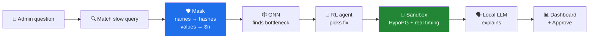

<div align="center">

# 🛡️ PrivyTune
### AI database tuning that never sees your data

**Ask why a query is slow. Get a tested, explained fix.
The AI only ever sees masked metadata — zero raw values.**


*Code Utsava X.0 · Problem Statement 4 — AI Database Tuning with Data Privacy* · [Problem statement](PS4.md)

</div>

---

## ✨ What it does

An admin types a plain-English question — *"Why is the weekly sales report slow?"* — and PrivyTune:

1. **Finds** the slow query and its execution plan.
2. **Masks** everything: table and column names become keyed hashes (`orders` → `t_438`), every value becomes a placeholder (`$1`, `$2`).
3. **Spots the bottleneck** with a Graph Neural Network that reads the plan as a graph — every pick double-checked by rules.
4. **Picks the best fix** with a reinforcement-learning agent: index, monthly partitioning, or a SQL rewrite — weighing speed against write cost.
5. **Tests it safely** with HypoPG "pretend" indexes and real timings on a sandbox copy — never the live tables.
6. **Explains it** in plain English with a local LLM, and shows an **Approve** button that only *displays* the SQL script.

> **Privacy guarantee:** the AI and the LLM receive masked metadata only. A leak checker blocks the analysis if anything real slips through.

## 🧭 How it works



Everything left of the masking step stays on the real side (`db/`, `privacy/`); everything right of it sees **masked data only** (`ai/`, `app/llm.py`). The boundary lives in [`pipeline.py`](pipeline.py).

## 📈 Results

Measured on **5 million orders**, timings are the median of several sandbox runs, and every rewrite is checksum-verified to return identical rows.

| Query | Top fix | Measured gain |
|---|---|---:|
| q03 · recent pending orders | partition + index | **97%** |
| q01 · customer order history | index | **89–91%** |
| q06 · top electronics last quarter | partition | **66–76%** |
| q11 · weekly sales report *(demo)* | partition + index + join rewrite | **54–66%** |
| q02 · monthly sales by region | partition | **59–62%** |
| q08 · monthly revenue 2025 | partition | 33% — needs a summary table |

**Rewrites:** correlated subquery → JOIN **17.8× faster** · `NOT IN` → `NOT EXISTS` **>50× faster** · function → range **2.7× faster**.
**Privacy:** 11/11 demo queries and 100/100 unseen queries fully masked — **0 leaks**.
**Live dashboard run (q11):** 104 ms → 37 ms (**64.8% faster**), +0.003 ms per insert, +33 MB storage.

Full per-query numbers: [`ai/RESULTS.md`](ai/RESULTS.md).

<details>
<summary><b>🔬 Does the simulator tell the truth?</b> — HypoPG estimate vs real index</summary>

| Index | HypoPG estimate | Real size | Error | Extra write / row |
|---|---:|---:|---:|---|
| `orders (customer_id)` | 116.1 MB | 35.6 MB | +226% | ~2–3 µs |
| `orders (product_id)` | 116.1 MB | 35.4 MB | +228% | ~1–3 µs |
| `orders (region_id, order_date)` | 145.2 MB | 35.9 MB | +304% | ~2 µs |

HypoPG overestimates index size **3–4×** (it ignores B-tree deduplication). So we use it only to **rank** fixes fast, and the dashboard reports the **real** size, measured by building the index on the sandbox copy. Run: `python -m db.accuracy`.
</details>

<details>
<summary><b>🌍 Does it work on real data?</b> — UCI Online Retail II</summary>

Real sales of a UK online gift shop (Dec 2009 – Dec 2011): 1,033,036 invoice lines, loaded into a separate `retail` database with the real mess kept (guest invoices, cancellations).

| Real question | Before | After | Faster |
|---|---:|---:|---:|
| Purchase history of one customer | 27.3 ms | 2.5 ms | **91%** |
| Monthly sales of the best seller | 31.1 ms | 11.1 ms | **64%** |
| Top 10 products, Christmas 2010 | 31.1 ms | 25.7 ms | 17–53% *(unstable)* |
| Revenue by country, 2011 | 81.5 ms | — | no fix — correctly reported |
| Last purchase of each German customer | 236.4 ms | 1.5 ms | **99%** |

Identical answers, checksum-verified. Run: `python -m db.retail` then `python -m db.retail_queries`. Checked at sandbox level; the dashboard runs on the synthetic `sales` data.
</details>

## 🚀 Quick start

**Needs:** Docker Desktop · Python 3.12 · [Ollama](https://ollama.com) · an NVIDIA GPU is optional (GNN training).

```bash
# 1. Database: Postgres 16 + HypoPG + pg_stat_statements
docker compose up -d

# 2. Python environment
py -3.12 -m venv .venv
.venv\Scripts\python -m pip install torch --index-url https://download.pytorch.org/whl/cu128
.venv\Scripts\python -m pip install -r requirements.txt

# 3. Local LLM
ollama pull qwen2.5:7b

# 4. Secret masking key (once; never commit it)
.venv\Scripts\python -c "import secrets, pathlib; pathlib.Path('.secret_key').write_text(secrets.token_hex(32))"

# 5. Data: seeded fake sales shop (5M orders, ~30 s)
.venv\Scripts\python db\generate.py 5000000

# 6. Run
.venv\Scripts\streamlit run app\dashboard.py
```

> The key path is set by `KEY_FILE` at the top of [`privacy/mask.py`](privacy/mask.py) — point it at your `.secret_key`. A missing or empty key **stops** the masker on purpose: a new key would silently change every code.

💡 **Tip:** turn on **Demo mode** in the sidebar for instant answers from recorded real runs — a live analysis times every fix and takes about a minute.

## 🗂️ Project layout

| Folder | What lives there |
|---|---|
| [`db/`](db) | Seeded data generator, 11 slow queries, **sandbox** (HypoPG cost, partition simulation, real timing, write/storage impact), plan logging, query-variant generator, real-data check |
| [`privacy/`](privacy) | **Masking** (keyed hashes, `$n` placeholders, column bitmask), un-masking for the admin, leak checker, optional voice — see [HOW_MASKING_WORKS.md](privacy/HOW_MASKING_WORKS.md) |
| [`ai/`](ai) | **GNN** bottleneck finder, **RL** fix picker, 4 SQL rewrite rules, rewrite verification — see [ai/README.md](ai/README.md) |
| [`app/`](app) | Streamlit **dashboard**, local LLM explanations, Approve script, Demo mode |
| [`pipeline.py`](pipeline.py) | `analyze(question)` — wires everything and enforces the privacy boundary |

Every module runs on its own as a self-test, e.g. `python -m privacy.mask`, `python -m db.sandbox`, `python -m app.test_privacy`.

## 🛡️ Privacy in detail

| Hidden — never reaches the AI | Kept — the AI needs it to reason |
|---|---|
| Table and column names → `t_438`, `c_13b` | SQL keywords and functions (`JOIN`, `SUM`, `DATE_TRUNC`) |
| Aliases and labels → `a1`, `x1` | Query shape: joins, filters, `GROUP BY 1` positions |
| Every value (ids, dates, `'pending'`) → `$1`, `$2` | Date units (`'week'`, `'month'`) |
| Index names → `i_d3e` | Plan numbers: costs, row estimates |

- **Keyed hashing (HMAC-SHA256):** without the secret key, nobody can rebuild a code by hashing a guessed name.
- **Equality only:** a repeated value reuses its number, so the AI learns two values are *equal* — never what they are.
- **Metadata, not data:** row counts, selectivities, costs and result checksums describe the data's shape; table contents never leave the real side.
- **Leak check:** scans everything sent to the AI and the LLM for real names, values, emails and card numbers — and stops the analysis if anything is found.

## ⚠️ Honest limitations

- **Partitioning is simulated on a copy.** HypoPG can only fake indexes, so partitions are tested on a partitioned sandbox copy of `orders`.
- **Sharding** needs several servers; partitioning is presented as its single-machine form.
- **The GNN does not beat simple rules** (54/59 vs 59/59 on test plans). The GNN writes every reason and the rules check every pick, so accuracy stays at the rules' level.
- **Optional voice uses ElevenLabs (online).** Spoken answers are generated from masked, leak-checked text only, but spoken *questions* are sent as audio and can't be leak-checked first. Typed questions and the whole analysis stay local. No API key = voice off.
- **Live analysis takes about a minute** (each fix is timed 5×). Use Demo mode for presentations.

## 🧑‍💻 Team

Built in 24 hours by a team of four, each owning one module in a separate git worktree, merged through a shared interface contract ([`CLAUDE.md`](CLAUDE.md)):

| | Module |
|---|---|
| **Person 1** | Database, sandbox, ingestion |
| **Person 2** | Privacy and masking |
| **Person 3** | GNN, RL agent, rewrites |
| **Person 4** | Dashboard, LLM, pipeline |

## 📚 References

- [HypoPG](https://github.com/HypoPG/hypopg) — hypothetical indexes for PostgreSQL
- [sqlglot](https://github.com/tobymao/sqlglot) — SQL parser and transpiler
- Kipf & Welling, *Semi-Supervised Classification with Graph Convolutional Networks*, ICLR 2017
- Li et al., *A Contextual-Bandit Approach to Personalized News Article Recommendation*, WWW 2010
- Marcus et al., *Bao: Making Learned Query Optimization Practical*, SIGMOD 2021
- Dataset: [UCI Online Retail II](https://archive.ics.uci.edu/dataset/502/online+retail+ii)
- Krawczyk et al., *HMAC: Keyed-Hashing for Message Authentication*, RFC 2104
